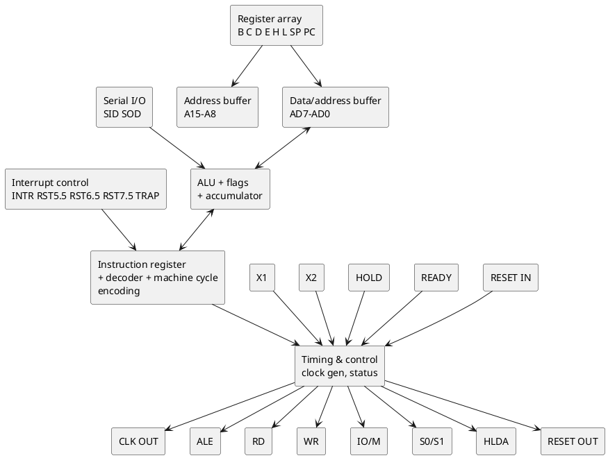
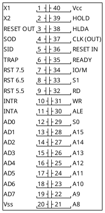
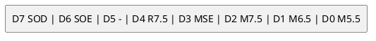
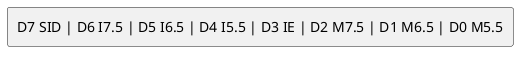

# Intel 8085AH - 8-bit HMOS microprocessor

Re-creation of the Intel 8085AH/8085AH-2/8085AH-1 datasheet (order no.
231718-001, Sept 1987) in this repo's own words. Pin numbers, interrupt table
and pin functions were checked against the scan (pages 1-1.14); AC/DC
timing is not reproduced, and the RIM/SIM bit layouts below are from the
8080/8085 User's Manual (referenced by the datasheet), not read from this
scan. This board's CPU is an 8085 (U40); the 1979 part is the older 8085A -
same pinout and instruction set.

## Block diagram

## Pin diagram (40-pin DIP)

(RD, WR, INTA, RESET IN, RESET OUT are active low in the real part, drawn
with overbars in the datasheet; IO/M is low for memory, high for I/O.)

## Pins

| Pin | Name | Dir | Function |
|---|---|---|---|
| 1, 2 | X1, X2 | in | Crystal/LC/RC; X1 may take an external clock. **Frequency is divided by 2** to give CLK |
| 3 | RESET OUT | out | High while the CPU is being reset; usable as a system reset |
| 4 | SOD | out | Serial output, set by SIM |
| 5 | SID | in | Serial input, read into A bit 7 by RIM |
| 6 | TRAP | in | Non-maskable restart, rising edge + level, highest priority |
| 7, 8, 9 | RST 7.5 / 6.5 / 5.5 | in | Maskable restart inputs |
| 10 | INTR | in | General interrupt, level, vector supplied via INTA |
| 11 | INTA | out | Interrupt acknowledge |
| 12-19 | AD0-AD7 | I/O | Low address byte (T1), then data |
| 21-28 | A8-A15 | out | High address byte |
| 29, 33, 34 | S0, S1, IO/M | out | Machine-cycle status |
| 30 | ALE | out | Address latch enable (falling edge latches AD0-7) |
| 31 | WR | out | Write strobe, active low |
| 32 | RD | out | Read strobe, active low |
| 35 | READY | in | Low inserts wait states |
| 36 | RESET IN | in | Schmitt input; low >= 10 ms after Vcc is up, >= 3 clocks otherwise |
| 37 | CLK OUT | out | System clock, period = 2 x X1 period |
| 38 | HLDA | out | Hold acknowledge |
| 39 | HOLD | in | Bus request |
| 40 / 20 | Vcc / Vss | | +5 V (10 %) / ground |

### Machine cycle status

| IO/M | S1 | S0 | Cycle |
|---|---|---|---|
| 0 | 0 | 1 | Memory write |
| 0 | 1 | 0 | Memory read |
| 1 | 0 | 1 | I/O write |
| 1 | 1 | 0 | I/O read |
| 0 | 1 | 1 | Opcode fetch |
| 1 | 1 | 1 | Interrupt acknowledge |

On this board, **IO/M (pin 34) is not decoded as I/O**: the firmware has no
IN/OUT instructions, and peripherals are memory-mapped (see
[../hardware.md](../hardware.md)).

## Interrupts

| Name | Priority | Vector | Trigger |
|---|---|---|---|
| TRAP | 1 (highest) | `0024` | Rising edge AND high until sampled; not maskable |
| RST 7.5 | 2 | `003C` | Rising edge, latched (stays set until serviced or reset by SIM) |
| RST 6.5 | 3 | `0034` | High level until sampled |
| RST 5.5 | 4 | `002C` | High level until sampled |
| INTR | 5 | per instruction supplied | High level until sampled |

Any restart pushes PC and branches to the vector; all three RST inputs can be
masked individually with SIM, and RESET IN clears the mask state.

### SIM (accumulator on entry)

| Bit | Meaning |
|---|---|
| SOD / SOE | Serial data out / enable it |
| R7.5 | 1 = reset the RST 7.5 request flip-flop |
| MSE | 1 = apply the M7.5/M6.5/M5.5 mask bits |
| M7.5, M6.5, M5.5 | 1 = mask (disable) that interrupt |

### RIM (result in accumulator)

I7.5/I6.5/I5.5 are the pending flags, IE the interrupt-enable flip-flop,
M* the current masks.

## Register set

A, B, C, D, E, H, L (8-bit); BC, DE, HL pairs; SP, PC (16-bit); flags
S, Z, AC, P, CY. Instruction set is 8080-compatible plus RIM and SIM.

## This firmware

| Item | Value | Notes |
|---|---|---|
| Reset | PC = 0000, ROM 1 | Loran-C firmware starts there |
| SP | 7100 | top of the RAM at 6F00-70FF (8155 RAM) |
| Interrupt inputs used | RST 6.5 (receiver sample strobe, ISR at 0034), RST 7.5 (assumed 8155 timer out, 003C), RST 5.5 (8279 IRQ, **polled via RIM bit 4**, not vectored) | see [../hardware.md](../hardware.md) |
| SIM | `1DH` at `00AC`, `10H` at `047C` | `1DH` = reset RST 7.5, apply mask: mask 7.5 and 5.5, leave 6.5 enabled; `10H` only resets the 7.5 flip-flop |
| RIM | at `046C` (bit 6 = RST 7.5 pending), at `14D9` (bit 4 = RST 5.5 pending) | |
| SID / SOD | unused | |
| TRAP, INTR | not used | |
| Clock | X1 = TCXO (10 MHz per hardware.md), so CLK OUT = X1/2 = **5 MHz** if X1 is fed directly | see [../boot-sequence.md](../boot-sequence.md) for the 2.5 MHz baud-table discrepancy |
