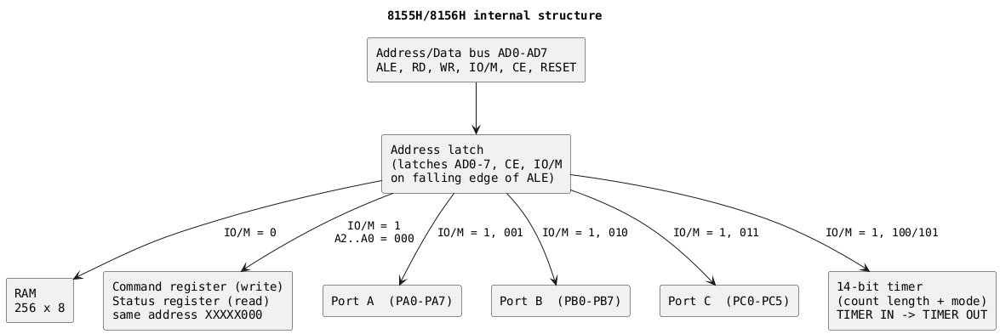
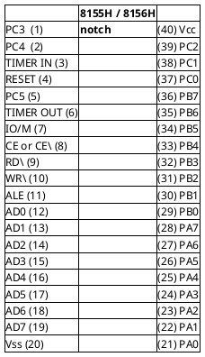
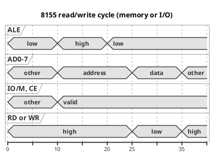

# Intel 8155H / 8156H (and -2) - 2048-bit RAM with I/O ports and timer

A reconstruction, in this project's own words and diagrams, of the data in
Intel's *8155H/8156H/8155H-2/8156H-2* datasheet (order number 231719-001,
December 1986). This board's chips (U22, U35) are earlier 1979-era 8155s;
the HMOS "H" parts are functionally the same, with the electrical numbers
below being the H-part figures. Where something differs in this firmware's
use of the chip, see [../hardware.md](../hardware.md); pin cross-references
are in [../peripheral-pinouts.md](../peripheral-pinouts.md).

Verification status: the pin diagram, register formats, address scheme and
timer modes were read directly from the datasheet scan. The electrical
tables are reproduced as numbers to the best of the scan's legibility;
check the original before designing to a margin.

## What it is

| Block | Size / function |
|---|---|
| RAM | 256 x 8 static |
| Port A, Port B | two 8-bit programmable I/O ports |
| Port C | one 6-bit port, plain I/O or handshake control for A and B |
| Timer | 14-bit down counter, square-wave or pulse output |
| Bus | multiplexed address/data, designed for the 8085 (8088 also) |

The **8155 vs 8156** difference is only the polarity of the chip-enable
pin: 8155 = `CE` active low, 8156 = `CE` active high. Everything else is
identical. The `-2` parts are the faster grade.

## Block diagram

## Pin configuration (40-pin DIP)

| Pins | Signal | Dir | Meaning |
|---|---|---|---|
| 12-19 | AD0-AD7 | I/O | Multiplexed low address / data from the 8085 |
| 11 | ALE | in | Latches the address, `CE` and `IO/M` on its falling edge |
| 9 | RD | in | Read strobe, active low |
| 10 | WR | in | Write strobe, active low |
| 8 | CE (8155: `CE`, 8156: CE) | in | Chip enable; polarity differs between 8155 and 8156 |
| 7 | IO/M | in | 0 = RAM, 1 = command/status, ports and timer |
| 4 | RESET | in | Clears all port latches, sets all three ports to input, **stops** the timer. Minimum width two 8085 clock cycles |
| 21-28 | PA0-PA7 | I/O | Port A |
| 29-36 | PB0-PB7 | I/O | Port B |
| 37, 38, 39, 1, 2, 5 | PC0-PC5 | I/O | Port C |
| 3 | TIMER IN | in | Timer clock input |
| 6 | TIMER OUT | out | Square wave or pulse, depending on mode |
| 40 / 20 | Vcc / Vss | - | +5 V / ground |

## Addressing

The register is chosen by `IO/M` = 1 (with `CE` active) and the low three
address bits; the upper five bits are don't-care **inside** the chip, so the
registers repeat every 8 addresses unless the board decoder says otherwise
(this board uses the 8155 at E000-E005 and F000-F005).

| A2 A1 A0 | Register |
|---|---|
| 000 | Command (write) / Status (read) |
| 001 | Port A data |
| 010 | Port B data |
| 011 | Port C data (6 bits) |
| 100 | Timer count length, low 8 bits |
| 101 | Timer count length high 6 bits + 2 mode bits |

With `IO/M` = 0 the full 8-bit address selects one of 256 RAM bytes.

## Command register (write to XXXXX000)

```plantuml
@startuml
skinparam monochrome true
skinparam defaultFontName monospaced
salt
{#
**bit 7** | **6** | **5** | **4** | **3** | **2** | **1** | **0**
TM2 | TM1 | IEB | IEA | PC2 | PC1 | PB | PA
}
@enduml
```

| Bits | Field | Values |
|---|---|---|
| 0 | PA direction | 0 = input, 1 = output |
| 1 | PB direction | 0 = input, 1 = output |
| 3-2 | Port C mode (PC2 PC1) | 00 ALT1: all input; 11 ALT2: all output; 01 ALT3: PC0-2 = port A handshake, PC3-5 output; 10 ALT4: PC0-2 = port A handshake, PC3-5 = port B handshake |
| 4 | Port A interrupt enable | 1 = enable |
| 5 | Port B interrupt enable | 1 = enable |
| 7-6 | Timer command (TM2 TM1) | 00 NOP; 01 stop (NOP if not started); 10 stop after terminal count (stop immediately if timer not started); 11 **start** - load the new length/mode, start immediately if the timer is stopped, or after the present terminal count if it is running |

(The command register can be written at any time but never read back.)

### The two values this firmware uses

| Value | Binary | Effect |
|---|---|---|
| `0CFH` | 1100 1111 | PA out, PB out, PC all output (ALT2), start timer. 8155 #1 |
| `0C3H` | 1100 0011 | PA out, PB out, PC all **input** (ALT1), start timer. 8155 #2 |

## Status register (read XXXXX000)

| Bit | Meaning |
|---|---|
| 0 | Port A interrupt request |
| 1 | Port A buffer full/empty |
| 2 | Port A interrupt enabled |
| 3 | Port B interrupt request |
| 4 | Port B buffer full/empty |
| 5 | Port B interrupt enabled |
| 6 | Timer interrupt - set when terminal count is reached, cleared by reading this register or by RESET |
| 7 | unused |

## Port C pin assignment by mode

| Pin | ALT 1 | ALT 2 | ALT 3 | ALT 4 |
|---|---|---|---|---|
| PC0 | input | output | A INTR | A INTR |
| PC1 | input | output | A BF | A BF |
| PC2 | input | output | A STB (input) | A STB (input) |
| PC3 | input | output | output | B INTR |
| PC4 | input | output | output | B BF |
| PC5 | input | output | output | B STB (input) |

In handshake modes `INTR` and `BF` are outputs (INTR is low/high per
direction as in the table below) and `STB` is an input that strobes data in
or acknowledges data out.

| Control | Input mode | Output mode |
|---|---|---|
| BF | low | low |
| INTR | low | high |
| STB | input control | input control |

Other port behaviour worth remembering:

- Outputs are glitch-free: a bit written as 1 that was already 1 does not
  pulse the pin.
- Changing a port from input to output clears its output latch (the pins go
  low), and RESET clears all latches.
- Reading an output port returns the latch contents.
- Reading an input pin with nothing connected gives an indeterminate value.

## Timer

14-bit counter. Registers `XXXXX100` (low 8 bits) and `XXXXX101` (high 6
bits plus the mode in bits 7-6).

```plantuml
@startuml
skinparam monochrome true
skinparam defaultFontName monospaced
salt
{#
**bit 7** | **6** | **5** | **4** | **3** | **2** | **1** | **0**
M2 | M1 | T13 | T12 | T11 | T10 | T9 | T8
T7 | T6 | T5 | T4 | T3 | T2 | T1 | T0
}
@enduml
```

| M2 M1 | Mode | TIMER OUT |
|---|---|---|
| 00 | 1 - single square wave | high for the first half of the count, low for the second, then stops (one cycle) |
| 01 | 2 - continuous square wave | automatically reloads; high then low every period |
| 10 | 3 - single pulse | one low pulse (one clock wide) at terminal count |
| 11 | 4 - continuous pulses | one low pulse at every terminal count, automatic reload |

Rules and quirks:

- Count length is 2 to 3FFFH (**not** 1 - the square-wave mode counts down
  by twos twice per cycle).
- For an odd count in a square-wave mode the high half is one clock longer
  than the low half (count 9: 5 high, 4 low).
- RESET stops the timer but does not initialize it; nothing counts until a
  START command is written.
- To change the count/mode the timer must be re-started with a command
  `11` write after loading the new length (even to keep the old mode).
- To read the remaining count: stop the timer, read both bytes, clear the two
  mode bits, shift the 16-bit value right one place and add half the original
  count when a carry results (for an odd count the exact value cannot be
  recovered after the third count pulse).
- TIMER IN to TIMER OUT delay is 400 ns max (300 ns on -2).

This firmware: 8155 #1's timer runs a continuous square wave at count 07D0H
(mode 01), and 8155 #2's timer is reloaded with baud-rate divisors for the
8251A (count 458AH/4208H/4082H/4008H in the firmware = counts 058AH, 0208H,
0082H, 0008H with mode bits 01 - see the baud table in
[../hardware.md](../hardware.md)).

## Bus cycle

The chip latches AD0-7, `CE` and `IO/M` on the falling edge of ALE, then
`RD` or `WR` low transfers the data byte.

## Electrical characteristics (8155H/8156H)

| Parameter | Value |
|---|---|
| Supply | +5 V +/-10 % |
| Absolute max voltage on any pin | -0.5 V to +7 V |
| Power dissipation | 1.5 W max |
| Operating temperature | 0 to +70 C |
| Icc | 125 mA max |
| VIL / VIH | -0.5 to 0.8 V / 2.0 V to Vcc + 0.5 V |
| VOL (IOL = 2 mA) / VOH (IOH = -400 uA) | 0.45 V max / 2.4 V min |
| Input leakage | +/-10 uA |
| CE leakage | +100 uA (8155) / -100 uA (8156) |

### A.C. characteristics (selected, ns)

| Parameter | 8155H | 8155H-2 |
|---|---|---|
| Address to latch setup (tAL) | 50 min | 30 min |
| Address hold after latch (tLA) | 80 min | 30 min |
| Latch to RD/WR (tLC) | 100 min | 40 min |
| Read data valid after RD (tRD) | 170 max | 140 max |
| Latch to data valid (tLD) | 350 max | 270 max |
| Address to data valid (tAD) | 400 max | 330 max |
| Latch enable width (tLL) | 100 min | 70 min |
| RD/WR control width (tCC) | 250 min | 200 min |
| Data in setup before WR (tDW) | 150 min | 100 min |
| Data hold after WR (tWD) | 25 min | 25 min |
| WR to port output (tWP) | 400 max | 300 max |
| Port input setup (tPR) / hold (tRP) | 70 / 50 min | 50 / 10 min |
| Strobe width (tSS) | 200 min | 150 min |
| Strobe to buffer full / INTR on | 400 max | 300 max |
| TIMER IN low / high time | 80 / 120 min | 40 / 70 min |

Test conditions: C(load) = 150 pF; inputs driven 0.45 V / 2.4 V, timing
measured at 0.8 V / 2.0 V.

## Related

- 8085 minimum system: an 8155/8156 plus an 8755A EPROM/IO chip is the
  datasheet's own minimal 8085 system (256 bytes RAM, 2 KB EPROM, 38 I/O
  lines, a timer and four interrupts).
- This board: [../hardware.md](../hardware.md), [../peripheral-pinouts.md](../peripheral-pinouts.md).
