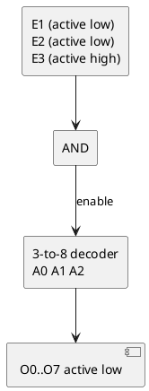

# Intel 8205 - High-speed 1-of-8 binary decoder

Re-creation of the Intel 8205 datasheet (Intel Component Data Catalog, Jan
1982, section 7, pp. 7-50..7-52) in this repo's own words. **Pinout and
truth table verified against the scan** - this replaces the earlier
"74LS138-equivalent, unverified" assumption (it is the same pinout). On this
board it is U45, the address decoder.

## Features

- 3-bit binary address to one-of-8 active-low outputs
- Three enable inputs: E1, E2 active low, E3 active high, ANDed together
- Schottky bipolar, 18 ns max delay; outputs sink 10 mA
- Input load 0.25 mA max (1/6 of a standard TTL load); input clamp diodes
- Decoders can be cascaded; 16-pin DIP

## Pin diagram (16-pin DIP)

```plantuml
@startsalt
{+
  {
    A0 | "1  ┤├ 16" | Vcc
    A1 | "2  ┤├ 15" | O0
    A2 | "3  ┤├ 14" | O1
    E1 | "4  ┤├ 13" | O2
    E2 | "5  ┤├ 12" | O3
    E3 | "6  ┤├ 11" | O4
    O7 | "7  ┤├ 10" | O5
    GND | "8  ┤├ 9" | O6
  }
}
@endsalt
```

| Pin | Name | Dir | Function |
|---|---|---|---|
| 1, 2, 3 | A0, A1, A2 | in | Binary address (A0 = LSB) |
| 4, 5 | E1, E2 | in | Enable, **active low** |
| 6 | E3 | in | Enable, **active high** |
| 15, 14, 13, 12, 11, 10, 9, 7 | O0 ... O7 | out | Decoded outputs, **active low** (selected = low) |
| 16 / 8 | Vcc / GND | | +5 V / ground |

## Function

The device is enabled when E1 = L, E2 = L and E3 = H; any other combination
leaves all eight outputs high.

| A2 A1 A0 | E1 E2 E3 | Output low |
|---|---|---|
| 0 0 0 | L L H | O0 |
| 0 0 1 | L L H | O1 |
| 0 1 0 | L L H | O2 |
| 0 1 1 | L L H | O3 |
| 1 0 0 | L L H | O4 |
| 1 0 1 | L L H | O5 |
| 1 1 0 | L L H | O6 |
| 1 1 1 | L L H | O7 |
| x x x | any other | none (all high) |

## Using it as a memory decoder

Feed A12-A14 into A0-A2 and gate with the enables (A15 / IO/M-style): each
output then selects one 4 KB block (`0000`, `1000`, ... `7000`) for ROMs and
peripherals. Unused outputs simply stay high.

## This firmware / board

| Item | Value | Notes |
|---|---|---|
| Part | U45 | identified by the user (hardware.md) |
| Model used in repo | `pal/*.pld`, `src/emu/addr-decode.js` | a PAL-equivalent decoder model of this TTL part |
| Expected mapping | O0 ROM1 (0000), O1 ROM2 (1000), O2 expansion (2000), ... | **Inferred**; confirm with trace-plan 1.1-1.3 |
| What to measure | E1/E2/E3 source nets, A0-A2 sources | whether A15 reaches an enable, and with which polarity (E3 is active high), settles the mirror behaviour |
