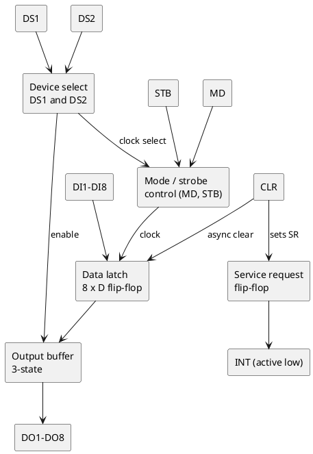

# Intel 8212 - 8-bit input/output port

Re-creation of the Intel 8212 datasheet (Intel Component Data Catalog, Jan
1982, section 7, pp. 7-55..7-59) in this repo's own words. Pinout and block
diagram checked against the scan; the exact mode truth table is summarised
from the functional description and the typical wirings it shows, and AC/DC
characteristics are not reproduced. On this board it is U39 (purpose still
unknown, see [../hardware.md](../hardware.md)).

## Features

- 8 D-type latches with tri-state, non-inverting output buffers
- Service-request flip-flop for interrupt generation (INT, active low)
- Asynchronous clear; two device-select inputs (DS1, DS2); mode input (MD)
- Input load 0.25 mA max, outputs sink 15 mA; 24-pin DIP
- Usable as a latch, gated buffer, multiplexer or bus driver

## Block diagram

## Pin diagram (24-pin DIP)

```plantuml
@startsalt
{+
  {
    DS1 | "1  ┤├ 24" | Vcc
    MD | "2  ┤├ 23" | INT
    DI1 | "3  ┤├ 22" | DI8
    DO1 | "4  ┤├ 21" | DO8
    DI2 | "5  ┤├ 20" | DI7
    DO2 | "6  ┤├ 19" | DO7
    DI3 | "7  ┤├ 18" | DI6
    DO3 | "8  ┤├ 17" | DO6
    DI4 | "9  ┤├ 16" | DI5
    DO4 | "10 ┤├ 15" | DO5
    STB | "11 ┤├ 14" | CLR
    GND | "12 ┤├ 13" | DS2
  }
}
@endsalt
```

| Pin | Name | Dir | Function |
|---|---|---|---|
| 3, 5, 7, 9, 16, 18, 20, 22 | DI1-DI8 | in | Data inputs |
| 4, 6, 8, 10, 15, 17, 19, 21 | DO1-DO8 | out | Data outputs (3-state, non-inverting) |
| 1 | DS1 | in | Device select, **active low** |
| 13 | DS2 | in | Device select, active high |
| 2 | MD | in | Mode: 1 = output mode, 0 = input mode |
| 11 | STB | in | Strobe: latch clock in output mode; falling edge also clears the service-request flip-flop |
| 14 | CLR | in | Asynchronous clear, active low: clears the data latch and sets SR |
| 23 | INT | out | Interrupt request, active low (inverse of SR) |
| 24 / 12 | Vcc / GND | | +5 V / ground |

The device is "selected" when DS1 = low and DS2 = high.

## Modes

| MD | Device selected? | Output buffer | Latch clock source |
|---|---|---|---|
| 1 (output mode) | any | always enabled | STB (latch follows DI while STB is high, holds when it falls) |
| 0 (input mode) | yes | enabled while selected | the select signal (DS1 and DS2); latch is transparent while selected |
| 0 (input mode) | no | high impedance | - |

Typical wirings from the datasheet's application section:

- **Latch / address latch:** MD = 1, STB driven by ALE-style strobe, output
  always enabled (how an 8212 latches the 8085's multiplexed low address
  byte).
- **Gated buffer:** MD = 0, DS1/DS2 as device select - passes DI to DO only
  when selected.
- **Output port with interrupt:** MD = 1, STB from a data-ready line, INT to
  the CPU; CLR or a select cycle resets the request.
- **Bidirectional bus driver:** a pair of 8212s wired back to back.

## Service-request flip-flop

SR is set by CLR (low) and cleared by the falling edge of STB while the
device is selected. INT is its inverse, so a falling STB edge raises an
interrupt request and CLR returns it.

## This firmware / board

| Item | Value | Notes |
|---|---|---|
| Part | U39 | designator conflict with the OPTION sockets (hardware.md) |
| Software access | none seen | no memory-mapped address found for it in the decoder reconstruction (`latch8212` in the emulator is a placeholder) |
| What to trace | DS1/DS2 sources, STB source, MD level, DI sources, DO destinations | trace-plan 1.8: MD tied high with STB from a CPU strobe is a pure latch; DS1/DS2 from a decoder output means it is I/O mapped |
