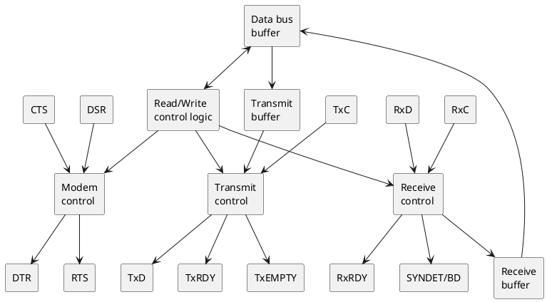
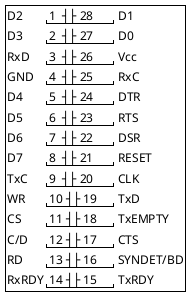
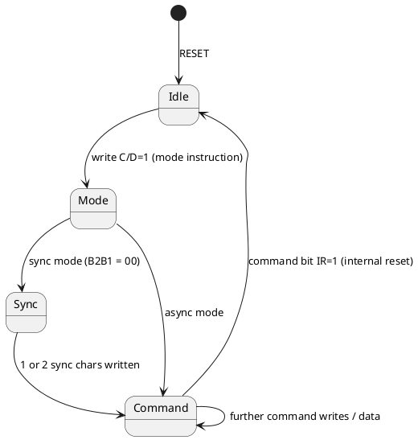
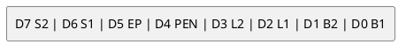
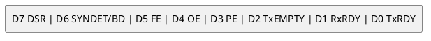

# Intel 8251A - USART (Programmable Communication Interface)

Re-creation of the Intel 8251A datasheet (order no. 205222-002) in this
repo's own words and diagrams. Pin numbers and register layouts were checked
against the scan (pp. 1-17 read, including the synchronous-mode bit layout,
Fig. 10); only the headline timing values below are reproduced - use the
original for the rest.

Key bus timing (0-70 C, Vcc 5 V +/-10%): READ pulse >= 250 ns, data valid
<= 200 ns after READ; WRITE pulse >= 250 ns, data setup >= 150 ns, hold
>= 20 ns; write recovery >= 6 tCY (async) / 16 tCY (sync). TxC/RxC <= 1/30 of
CLK at 1x, <= 1/4.5 of CLK at 16x/64x; reset pulse >= 6 tCY with CLK running. Used on this board as the host serial port (8251A at
`C000`/`C001`, see [../hardware.md](../hardware.md)).

## Features

- Synchronous (5-8 bit chars, internal or external sync, 1 or 2 sync chars)
  and asynchronous (5-8 bit chars, 1x/16x/64x clock, 1 / 1.5 / 2 stop bits)
- Double-buffered transmitter and receiver (no FIFO)
- Baud rate: DC-64 K sync, DC-19.2 K async
- Parity generation/checking; parity, overrun and framing error flags
- Automatic break detect (async); false-start-bit detection
- Modem controls: DTR, RTS outputs, DSR, CTS inputs
- Needs CLK > 30x the Tx/Rx baud rate; RESET must be high for >= 6 clocks

## Block diagram

## Pin diagram (28-pin DIP)

| Pin | Name | Dir | Function |
|---|---|---|---|
| 27,28,1,2,5,6,7,8 | D0-D7 | I/O | 8-bit data bus |
| 21 | RESET | in | High >= 6 clocks resets to idle |
| 20 | CLK | in | Internal timing; not the baud clock |
| 10 | WR | in | Write strobe, active low |
| 13 | RD | in | Read strobe, active low |
| 12 | C/D | in | 0 = data, 1 = control/status |
| 11 | CS | in | Chip select, active low |
| 19 | TxD | out | Transmit data |
| 9 | TxC | in | Transmit clock (data shifts out on falling edge) |
| 15 | TxRDY | out | Tx buffer empty AND CTS=0 AND TxEN=1 |
| 18 | TxEMPTY | out | Tx shift register empty |
| 3 | RxD | in | Receive data |
| 25 | RxC | in | Receive clock (sampled on rising edge) |
| 14 | RxRDY | out | Receive char ready for CPU |
| 16 | SYNDET/BD | I/O | Sync detect (sync) or break detect (async) |
| 22 | DSR | in | Data set ready (status bit 7) |
| 24 | DTR | out | Data terminal ready (inverted from command bit) |
| 23 | RTS | out | Request to send (inverted from command bit) |
| 17 | CTS | in | Clear to send; Tx enabled only while low |
| 26 / 4 | Vcc / GND | | +5 V / ground |

## CPU access

| C/D | RD | WR | CS | Operation |
|---|---|---|---|---|
| 0 | 0 | 1 | 0 | Read received data |
| 0 | 1 | 0 | 0 | Write data to transmit |
| 1 | 0 | 1 | 0 | Read status |
| 1 | 1 | 0 | 0 | Write mode / sync / command |
| x | x | x | 1 | Bus floats |

## Programming sequence

The first control write after reset is always the mode instruction; every
later control write is a command until an internal reset.

Safe power-up sequence (device state unknown): write three 00H bytes to
C/D=1, then command 40H (internal reset). That forces the chip into
command-format regardless of where it started.

## Mode instruction

### Asynchronous

| Field | Values |
|---|---|
| B2 B1 | 00 sync mode, 01 = 1x, 10 = 16x, 11 = 64x clock |
| L2 L1 | 00 = 5, 01 = 6, 10 = 7, 11 = 8 data bits |
| PEN | 1 = parity enabled |
| EP | 1 = even parity, 0 = odd |
| S2 S1 | 01 = 1, 10 = 1.5, 11 = 2 stop bits (00 invalid) |

### Synchronous

| Bit | Name | Meaning |
|---|---|---|
| D7 | SCS | 1 = single sync char, 0 = two |
| D6 | ESD | 1 = external sync detect (SYNDET is an input) |
| D5 | EP | 1 = even parity |
| D4 | PEN | 1 = parity enabled |
| D3,D2 | L2,L1 | char length as above |
| D1,D0 | 0 0 | selects sync mode |

Sync characters follow the mode byte (one or two). Receiver Hunt mode
searches for the sync pattern; SYNDET is cleared by each status read.

## Command instruction

| Bit | Name | 1 means |
|---|---|---|
| D0 | TxEN | Transmitter enabled |
| D1 | DTR | Force DTR pin low |
| D2 | RxE | Receiver enabled |
| D3 | SBRK | Force TxD low (send break) |
| D4 | ER | Reset PE/OE/FE flags |
| D5 | RTS | Force RTS pin low |
| D6 | IR | Internal reset, return to mode format |
| D7 | EH | Enter hunt mode (sync only) |

Error reset must be issued whenever RxE and EH are programmed.

## Status register

| Bit | Name | Meaning |
|---|---|---|
| D0 | TxRDY | Tx data buffer empty. **Not** gated by CTS/TxEN (unlike the pin) |
| D1 | RxRDY | A received character is waiting |
| D2 | TxEMPTY | Tx shift register empty (underrun in sync mode) |
| D3 | PE | Parity error (cleared by ER; does not stop operation) |
| D4 | OE | Overrun: char not read before next arrived |
| D5 | FE | Framing error (async: missing stop bit) |
| D6 | SYNDET/BD | Sync detected (sync) or break (async) |
| D7 | DSR | DSR pin is low |

Status can lag the real event by up to 28 clock periods.

## Async receive behaviour

- Start bit validated at mid-bit (false-start rejection)
- Only one stop bit is checked, whatever the mode word says
- Break = two consecutive all-zero frames including stop bits
- Data is sampled on RxC rising edge; transmit shifts on TxC falling edge

## This firmware

| Item | Value | Notes |
|---|---|---|
| Address | C000 data, C001 control/status | A0 = C/D |
| Mode byte | `0DAH` | 16x, 7 data bits, parity enabled, odd, 2 stop bits = 7O2 |
| Command byte | `37H` | TxEN, DTR, RxE, ER, RTS - no break, no reset |
| Handshake | Polled TxRDY/RxRDY | No interrupt wiring is used; a software ring buffer (PRTBUF) compensates for the missing FIFO |

See [../serial-protocol.md](../serial-protocol.md) for the message format.
