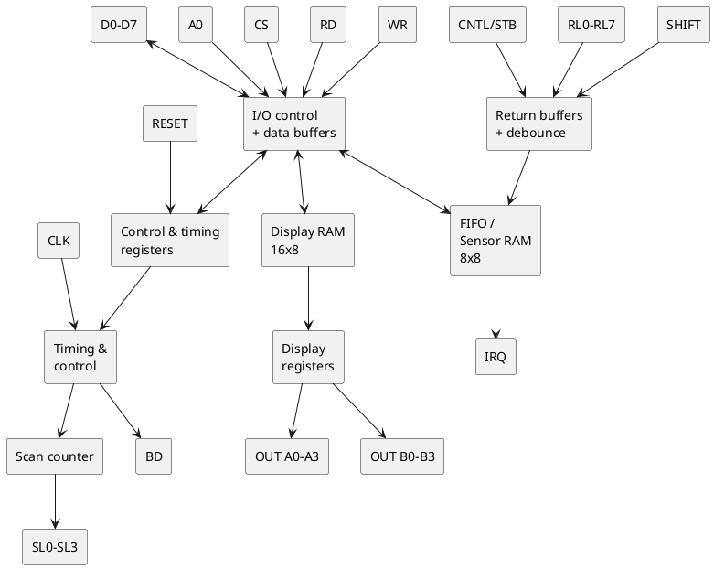
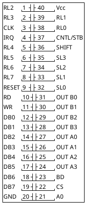
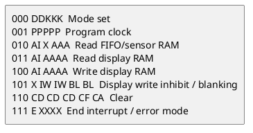
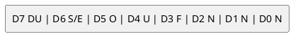

# Intel 8279 - Programmable Keyboard/Display Interface

Re-creation of the Intel 8279/8279-5 datasheet (order no. 290123-002) in this
repo's own words and diagrams. Pin numbers, command encodings and the status
word were checked against the scan (pp. 2-16); only headline AC timing is
given (see below). On this
board the 8279 sits at `D000` (data) / `D001` (command/status) and scans the
front-panel switches and 7-segment display (see
[../hardware.md](../hardware.md), [../front-panel.md](../front-panel.md)).

## Key timing (0-70 C)

| Item | 8279 | 8279-5 |
|---|---|---|
| READ / WRITE pulse width | 420 / 400 ns min | 250 / 250 ns min |
| Data delay from READ | 300 ns max | 150 ns max |
| Read / write cycle time | 1 us min | 1 us min |
| Clock period / pulse width | 500 / 230 ns min | 320 / 120 ns min |

With the prescaler programmed for a 10 us internal cycle: keyboard scan
5.1 ms, debounce 10.3 ms, display scan 10.3 ms, digit-on 480 us, blanking
160 us. Vcc 5 V +/-5% (8279) or +/-10% (8279-5). The firmware's prescaler of
6 therefore implies a ~600 kHz CLK (10 us / 6 = 1.67 us per CLK) - if the
board's 8279 CLK is not near 600 kHz the scan runs proportionally off-rate.
Probe pin 3 (trace-plan 1.6).

## What it does

- **Keyboard side:** scans a key matrix (8x8 encoded, or 4x8 decoded),
  debounces, and puts key codes in an 8-byte FIFO - or, in sensor-matrix mode,
  mirrors the raw switch state into an 8x8 "sensor RAM".
- **Display side:** refreshes up to 16 digits from a 16x8 display RAM
  (two 4-bit nibbles A and B per digit, or one 8-bit port).
- Interrupt output when the FIFO is non-empty / a sensor changed.
- Internal prescaler divides CLK down to ~100 kHz (5.1 ms keyboard scan for 8
  digits, 10.3 ms for 16; 10.3 ms debounce).

## Block diagram

## Pin diagram (40-pin DIP)

| Pin(s) | Name | Function |
|---|---|---|
| 19-12 | DB7-DB0 | Bidirectional data bus |
| 3 | CLK | Input clock for the prescaler |
| 9 | RESET | High = reset (16-char left-entry display, encoded 2-key lockout scan, prescaler = 31) |
| 22 | CS | Chip select, active low |
| 21 | A0 | 1 = command/status, 0 = data |
| 10 / 11 | RD / WR | Read / write strobes, active low |
| 4 | IRQ | High when FIFO has data (keyboard) or a sensor changed (sensor mode); falls with each FIFO read |
| 32-35 | SL0-SL3 | Scan lines, encoded (1-of-16, active high) or decoded (1-of-4, active low) |
| 38,39,1,2,5-8 | RL0-RL7 | Return lines, internal pull-ups; also the 8-bit strobed-input bus |
| 36 | SHIFT | Shift key input (keyboard modes), pulled up |
| 37 | CNTL/STB | Control key input, or strobe (rising edge) in strobed-input mode |
| 27-24 | OUT A0-A3 | High nibble display port |
| 31-28 | OUT B0-B3 | Low nibble display port |
| 23 | BD | Blank display, active low |
| 40 / 20 | Vcc / GND | |

Note: in decoded-scan keyboard mode only the first 4 display characters are
usable, because the scan lines are used both for keys and for digit selects.

## Registers and access

| A0 | RD | WR | Operation |
|---|---|---|---|
| 0 | 0 | 1 | Read data (FIFO or display RAM, whichever the last read command chose) |
| 0 | 1 | 0 | Write data to display RAM |
| 1 | 0 | 1 | Read status word |
| 1 | 1 | 0 | Write command |

Commands are identified by the top 3 bits.

## Commands

### 000 - Keyboard/display mode set: `0 0 0 D D K K K`

| DD | Display |
|---|---|
| 00 | 8 chars, left entry |
| 01 | 16 chars, left entry (reset default) |
| 10 | 8 chars, right entry |
| 11 | 16 chars, right entry |

| KKK | Keyboard mode |
|---|---|
| 000 | Encoded scan keyboard, 2-key lockout (reset default) |
| 001 | Decoded scan keyboard, 2-key lockout |
| 010 | Encoded scan keyboard, N-key rollover |
| 011 | Decoded scan keyboard, N-key rollover |
| 100 | **Encoded scan sensor matrix** |
| 101 | Decoded scan sensor matrix |
| 110 | Strobed input, encoded display scan |
| 111 | Strobed input, decoded display scan |

### 001 - Program clock: `0 0 1 P P P P P`

PPPPP (2..31) divides CLK to get ~100 kHz. 2 MHz CLK -> 20 (`10100`).
Reset value is 31.

### 010 - Read FIFO / sensor RAM: `0 1 0 AI X A A A`

Sets up reads (A0=0) to come from the FIFO (keyboard/strobed) or from sensor
RAM row AAA (sensor matrix). AI=1 auto-increments the sensor row on each read.
In FIFO modes AI and AAA are ignored.

### 011 - Read display RAM: `0 1 1 AI A A A A`

Selects display RAM address AAAA for reads; AI auto-increments after each read
or write.

### 100 - Write display RAM: `1 0 0 AI A A A A`

Selects the address for subsequent data writes (A0=0). Reads still come from
whichever source was last chosen, but this command moves the shared
auto-increment pointer.

### 101 - Display write inhibit / blanking: `1 0 1 X IW IW BL BL`

| Bits | Effect |
|---|---|
| IW (A, B) | 1 = writes from CPU don't affect that nibble (lets A and B be separate 4-bit ports) |
| BL (A, B) | 1 = blank that nibble (blank code set by last Clear) |

### 110 - Clear: `1 1 0 CD CD CD CF CA`

| CD CD CD | Display RAM is cleared to |
|---|---|
| 0 x | all zeros |
| 1 0 | `20H` (AB = 0010 0000) |
| 1 1 | all ones |

CF = clear FIFO and sensor-RAM pointer (also clears IRQ and the error flags).
CA = clear all: CD effect plus CF, and resynchronises the internal timing.
Clearing takes about 160 us; Display RAM is unavailable (DU set) during it.

### 111 - End interrupt / error mode set: `1 1 1 E X X X`

Sensor matrix modes: drops IRQ and re-enables writing to sensor RAM (needed
after a change interrupt). N-key rollover: E=1 selects special error mode in
which multiple simultaneous closures set the error flag.

## FIFO status word

Read with A0=1.

| Bit | Meaning |
|---|---|
| DU | Display unavailable (a Clear is still running) |
| S/E | Sensor closure (sensor mode) / multiple-closure error (special error mode) |
| O | FIFO overrun (write to full FIFO) |
| U | FIFO underrun (read from empty FIFO) |
| F | FIFO full |
| NNN | Number of entries in FIFO |

## Data formats

**Scanned keyboard FIFO byte:** `CNTL SHIFT | scan (3 bits) | return (3 bits)`.
CNTL is the MSB (inverted-sense lines: pressed = 0 on the pin).

**Sensor matrix:** each scan row's 8 return lines are copied directly into
sensor-RAM row = scan count; no debounce, so the CPU sees how long a switch
stayed closed. Change of any sensor raises IRQ (until the End-Interrupt
command, or the first data read if AI = 0).

**Strobed input:** the 8 return lines are latched into the FIFO on a rising
edge of CNTL/STB.

### Display entry

| Mode | Behaviour |
|---|---|
| Left entry | RAM address = digit position, first digit is the left-most; writing past the end wraps to digit 0 |
| Right entry | New character enters at the right and shifts the others left; the left-most falls off |

Auto-increment with an arbitrary start address in right-entry mode can
produce unexpected placement - start at 0 and enter sequentially.

16-character displays use half the duty cycle of 8-character ones
(10.3 ms vs 5.1 ms scan at 100 kHz).

## This firmware

| Item | Value | Notes |
|---|---|---|
| Data / command | `D000` / `D001` | A0 = address bit 0 |
| Mode set | `04H` | Encoded scan **sensor matrix** (KKK = 100), 8-char left-entry display |
| Prescaler | 6 | `26H` - gives a 100 kHz internal rate only with a 600 kHz CLK; real CLK source still to verify (board-trace-plan 1.6) |
| Clear | `0CDH` | `110 011 0 1`: CD bit 4 = 0 -> clear display RAM to zeros; CF = 0, CA = 1 -> clear all, resync |
| End interrupt | `0E0H` | Re-arm after sensor change |
| Interrupt | IRQ -> RST 5.5, **polled** with `RIM` bit 4 at `14D9` | not taken as a vectored interrupt |

The operator switches (GRI digits, mode switches) are read as sensor-matrix
rows; the emulator feeds them with `kdc.setSensorRow`. See
[../peripheral-pinouts.md](../peripheral-pinouts.md) for the 8279 wiring to J1.
