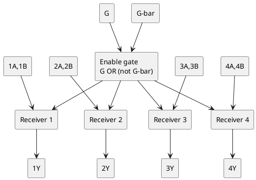
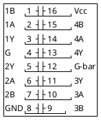

# AM26LS32 - quad differential line receiver

Re-creation, in this repo's own words, of the AM26LS32 datasheet. The
pinout, features and logic diagram were checked against the Texas Instruments
datasheet for the compatible AM26LS32A/AM26LS33A (SLLS115G); the board's part
is marked `AM26LS32DC` (AMD, ceramic DIP). The "A" version adds an extra
amplifier stage (higher sensitivity, slightly more delay) but is
interchangeable in application. An original AMD scan was not found.

## Features

- Four RS-422 / RS-423 receivers, ITU V.10 / V.11 compatible
- Common-mode range +/-7 V (LS32), +/-15 V (LS33); +/-200 mV sensitivity (LS32)
- Input hysteresis about 50 mV; input impedance 12 kohm min
- 3-state outputs with complementary enable inputs
- Open-input fail-safe: outputs go high when inputs are open
- Single +5 V supply; 16-pin DIP

## Logic diagram

## Pin diagram (16-pin DIP)

| Pin | Name | Function |
|---|---|---|
| 2, 1 | 1A, 1B | Receiver 1 differential input (A non-inverting, B inverting) |
| 6, 7 | 2A, 2B | Receiver 2 input |
| 10, 9 | 3A, 3B | Receiver 3 input |
| 14, 15 | 4A, 4B | Receiver 4 input |
| 3, 5, 11, 13 | 1Y, 2Y, 3Y, 4Y | Outputs, 3-state |
| 4 | G | Enable, active high |
| 12 | G-bar | Enable, active low (outputs enabled when G = H or G-bar = L) |
| 16 / 8 | Vcc / GND | |

## Function

With the outputs enabled, for each receiver:

| Differential input (A - B) | Output Y |
|---|---|
| >= +200 mV | High |
| <= -200 mV | Low |
| between, or inputs open | High (fail-safe on open inputs) |

With both enables inactive (G low and G-bar high) all outputs are
high-impedance.

## This firmware / board

| Item | Value | Notes |
|---|---|---|
| Part | "AM26LS32DC", near P5 (IO/TLS) and the serial path | hardware.md |
| Likely use | RS-422 receive path for the 8251A RxD and/or receiver-side signals | unconfirmed; trace-plan 1.11 |
| What to trace | which A/B pairs reach a connector, and which Y outputs reach U32 (8251A) or the PIO inputs | an unconnected pair reads as a steady high (mark) |
